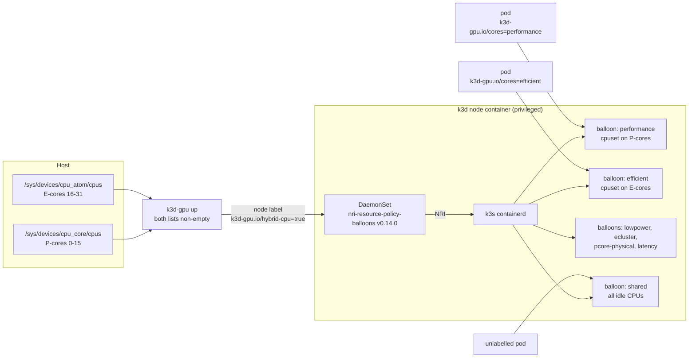

# k3d-gpu on Intel platforms

k3d-gpu turns one Linux machine into a single-node k3d cluster that schedules the
Intel accelerators it finds: Arc / Core Ultra / Xe GPUs, the Core Ultra NPU,
Gaudi 3, the Xeon DSA, IAA and QAT engines, AMX, and the P-cores and E-cores of
hybrid client CPUs. One command (`k3d-gpu up`) detects them from sysfs, starts
the matching Intel device plugins baked into the node image, and fails unless
each detected engine is advertised to the scheduler.

This page is for Intel's open-source, AI PC and partner engineering teams. It
says what is shipped, what has run on real hardware, and what has only run
against a simulated sysfs. Measured results are filled in from a ledger and are
never estimated. Every "no other" claim refers to the search log in
[provenance.md](https://github.com/88plug/k3d-gpu/blob/cbbc84e55d7f9a8270ccce9a7cec870304b76597/docs/provenance.md).

For every Xeon on-die engine and platform feature from E5 v2 to Diamond Rapids,
with detection, enablement and what k3d-gpu does with each, see the
[on-die accelerator reference](intel-on-die-accelerators.md).

- [What it adds](#what-it-adds)
- [Local Kubernetes landscape](#local-kubernetes-landscape)
- [Capability matrix](#capability-matrix)
- [Run Intel Enterprise Agent Toolkit on one machine](#run-intel-enterprise-agent-toolkit-on-one-machine)
- [How hybrid P/E pinning works](#how-hybrid-pe-pinning-works)
- [Roadmap](#roadmap)

---

## What it adds

- **One node image, every Intel plugin.** The image bakes pinned upstream
  manifests into k3s's auto-deploy directory:
  [intel-device-plugins-for-kubernetes](https://github.com/intel/intel-device-plugins-for-kubernetes)
  `0.37.1` (GPU, NPU, DSA, IAA, QAT), `intel/gaudi-device-plugin:1.24.2-481` and
  [nri-plugins](https://github.com/containers/nri-plugins/releases/tag/v0.15.0)
  balloons `v0.15.0`. With the default image nothing is `kubectl apply`'d at
  run time. If a custom `K3D_GPU_IMAGE` lacks a baked DaemonSet, `up` applies
  the manifest from `K3D_GPU_SHARE`; for NVIDIA with no local manifest it falls
  back to the upstream `main` branch manifest from GitHub, which is unpinned.
- **Detection from sysfs.** The launcher reads PCI vendor/device IDs, the bound
  driver, DRM render nodes and `/dev/accel` nodes. That is how it tells an NPU
  (`8086` + `intel_vpu`) from a Gaudi (`1da3` + `habanalabs`) behind the same
  `/dev/accel/accel*` path.
- **Label gating.** The NPU, DSA, IAA, QAT, Gaudi and hybrid/NUMA DaemonSets only
  schedule onto nodes carrying their label (the upstream NFD label where one
  exists, e.g. `intel.feature.node.kubernetes.io/npu=true`). The launcher sets
  the label only when the hardware and host setup are present. Two plugins are
  not gated by a positive label: the Intel GPU plugin runs on every amd64 node
  and idles, registering nothing, when there is no Intel GPU; the NVIDIA plugin
  runs unless the node carries `nvidia.com/gpu.present=false`, which `up` sets
  when NVIDIA is not active.
- **Platform-aware `doctor`.** Kernel and firmware checks per platform (Alder,
  Raptor, Meteor, Arrow, Lunar, Panther and Wildcat Lake, Battlemage, Nova Lake),
  the `xe.force_probe=<id>` or `i915.force_probe=<id>` needed for parts newer than
  the kernel, and the missing
  host step for DSA/IAA work queues (`accel-config`) and QAT VFs
  (`sriov_numvfs`, `vfio-pci`), each as an exact per-device apply and revert
  command. `up` and `detect` name the engines left out for want of that step.
  The launcher never changes host configuration itself; `host-setup --apply`
  runs the same commands after a y/N prompt.
- **A schedulability assertion.** `up` fails unless every detected engine has
  more than zero schedulable units. `test` runs one pod per engine: `nvidia-smi`
  for NVIDIA, a pod that requests the Intel resource and lists the device nodes
  it received, and for hybrid CPUs a check of the pod's `Cpus_allowed_list`
  against the host's P-core or E-core list.
- **P/E-core placement for pods.** One pod label,
  `k3d-gpu.io/cores: performance|efficient`, pins a pod to P-cores or E-cores.
  We found no other local Kubernetes that ships core-type-aware placement
  ([provenance.md, C2](https://github.com/88plug/k3d-gpu/blob/cbbc84e55d7f9a8270ccce9a7cec870304b76597/docs/provenance.md#3-c2-automatic-p-coree-core-pod-pinning-in-a-local-k8s)).

## Local Kubernetes landscape

Searched 2026-10-16 against each project's source at the commit linked. Where a
version is named, the link is that release tag's commit. Scope:
Kubernetes you run on one developer machine.

| Project | Accelerator support found | Intel GPU / NPU / Gaudi | Source |
|---------|---------------------------|-------------------------|--------|
| minikube v1.39.0 | `--gpus` accepts only `nvidia`, `nvidia.com`, `amd` or `all`, with the Docker driver and Docker runtime only. GPU addons are NVIDIA and AMD device plugins. | none | [`start.go#L1509`](https://github.com/kubernetes/minikube/blob/7a9f6a841470a207de8cf4bafcccee0969d8ba10/cmd/minikube/cmd/start.go#L1502-L1511), [`addons.go#L446-L476`](https://github.com/kubernetes/minikube/blob/7a9f6a841470a207de8cf4bafcccee0969d8ba10/pkg/minikube/assets/addons.go#L446-L476) |
| k3d v5.9.0 (upstream) | `--gpus` forwards Docker `DeviceRequests` (NVIDIA). The only accelerator doc is CUDA. No Intel mention in `docs/`, `cmd/` or `pkg/`. | none | [`docs/usage/advanced/`](https://github.com/k3d-io/k3d/tree/15dd1e2dbd62c53ed990fce9b7332335e8cb053c/docs/usage/advanced), [`translate.go#L107-L112`](https://github.com/k3d-io/k3d/blob/15dd1e2dbd62c53ed990fce9b7332335e8cb053c/pkg/runtimes/docker/translate.go#L107-L112) |
| MicroK8s | Core addons `nvidia` and `gpu` ("Alias to nvidia add-on"); community addon `amd`. Neither repo lists an Intel addon. | none | [core `addons.yaml#L72-L83`](https://github.com/canonical/microk8s-core-addons/blob/0f192230dc3df263eb95b6be4c3f00a6ea037879/addons.yaml#L72-L83), [community `addons.yaml#L237-L240`](https://github.com/canonical/microk8s-community-addons/blob/151b98e87dc7c29411cac7127170dc1c7605ec33/addons.yaml#L237-L240) |
| Rancher Desktop v1.24.0 | None. The Rancher Desktop 2 alpha announcement says "GPU support isn't built yet"; GPU requests are open issues ([#5561](https://github.com/rancher-sandbox/rancher-desktop/issues/5561), [#8487](https://github.com/rancher-sandbox/rancher-desktop/issues/8487), [#3968](https://github.com/rancher-sandbox/rancher-desktop/issues/3968)). | none | [blog post, L46-L48](https://github.com/rancher-sandbox/docs.rancherdesktop.io/blob/0a32ddb28ccba0ee344b587fb61a9b53e2281619/blog/2026-06-19-welcome-to-rancher-desktop-2.md?plain=1#L46-L48) |
| kind | None. "Device plugin, e.g. GPU" is listed under lowest-priority scope; [#3164](https://github.com/kubernetes-sigs/kind/issues/3164) "Support GPUs" is open. | none | [`project-scope.md#L104`](https://github.com/kubernetes-sigs/kind/blob/214d9fd1426470dcfa0d8aa1c5dda03bfea835cb/site/content/docs/contributing/project-scope.md?plain=1#L104) |
| Talos Linux | System extensions `i915`, `xe` and `intel-npu` ship kernel modules and firmware only; NVIDIA has a container-toolkit extension. No Intel device plugin is shipped. | kernel modules only | [`drm/`](https://github.com/siderolabs/extensions/tree/6e96d79367783e1c93f4aa5ed5bc7641a9a6604f/drm), [`nvidia-gpu/`](https://github.com/siderolabs/extensions/tree/6e96d79367783e1c93f4aa5ed5bc7641a9a6604f/nvidia-gpu) |

Any of these can run Intel's device plugins if you install and configure them
yourself. The difference is that k3d-gpu detects the hardware, gates and starts
the plugins, and asserts the result, with no manual step.

---

## Capability matrix

- **Detected**: `k3d-gpu detect` reports the engine from sysfs.
- **Scheduled**: `k3d-gpu up` starts its plugin (or sets its labels) and fails
  unless the cluster advertises more than zero units.
- **Verified on hardware**: `up` and `test` passed on a real host. The only host
  so far is an i9-13900T (P-cores 0-15, E-cores 16-31) with a UHD 770 iGPU
  (`8086:a780`, `i915`) and 2 NVIDIA GPUs, recorded in the
  [PR #9 test plan](https://github.com/88plug/k3d-gpu/pull/9): `up` reported
  `nvidia=2, intel=1, hybrid=1`. That run used commit `109154d`. The hybrid
  `test` there only checked that each pod printed its `Cpus_allowed_list`; the
  stricter check that the list sits inside the P-core or E-core list landed
  after it (`fb5c17d`) and has not yet run on hardware.
- **Verified by sim**: `tests/detect_test.sh` builds a fake sysfs/devfs tree,
  sets `K3D_GPU_SYSROOT`, and runs `detect`, `doctor` or `test` against it, with
  `docker`, `k3d` and `kubectl` stubbed. 1028 cases pass (2026-10-20). Sim covers detection,
  diagnostics and the `test` pass/fail logic. It does not prove a plugin
  advertises the device.

| Engine | Kubernetes resource / label | Detected | Scheduled | Verified on hardware | Verified by sim (cases in `tests/detect_test.sh`) |
|--------|-----------------------------|----------|-----------|----------------------|------------------------------------------------|
| NVIDIA GPU | `nvidia.com/gpu` | yes | yes | **yes**, 2 GPUs; `nvidia-smi` pod passed | loaded module; `/dev/nvidiactl`; runtime vs. CDI-only; `test` output and failure |
| Intel GPU, `i915` | `gpu.intel.com/i915`; node labels `gpu.intel.com/xmx`, `media-vcs`, `media-vecs` | yes | yes | **yes**, UHD 770; device-listing pod passed | Alder / Raptor Lake names, kernels and GuC firmware, Meteor Lake, Arrow Lake-H/-S, mixed `i915` + `xe`, XMX and media-engine labels |
| Intel GPU, `xe` (Battlemage, Lunar / Panther Lake, Crescent Island) | `gpu.intel.com/xe` | yes | yes | no | Lunar Lake, Battlemage dGPU, kernel/firmware checks, `xe.force_probe` hints, `vfio-pci` excluded |
| Intel NPU | `npu.intel.com/accel`; node label `k3d-gpu.io/npu.gen` | yes | yes | no | Lunar / Meteor Lake, `0x7d1d` named by CPU model (Meteor Lake vs. Arrow Lake-H), NPU vs. Gaudi, unbound NPU, firmware checks, forced `npu` fails `doctor` |
| Gaudi 3 | `habana.ai/gaudi` | yes | yes (plain mode, no habana runtime) | no | `habanalabs` accel nodes, no-driver case, NPU + Gaudi on one host |
| DSA | `dsa.intel.com/wq-user-*` | yes | yes | no | user work queues, no-work-queue case with per-device `accel-config` apply/revert (dedicated, or shared with PASID), kernel-WQ device opt-in (snapshot, own group on a free engine), forced `dsa` fails `doctor` |
| IAA | `iaa.intel.com/wq-user-*` | yes | yes | no | user work queues, no-work-queue case with per-device `accel-config` apply/revert, iaa_crypto kernel-WQ opt-in with a snapshot revert, no room left, live zswap `deflate-iaa` left alone |
| QAT (C62x, 4xxx, 420xx, 6xxx) | `qat.intel.com/*` | yes | yes | no | 4xxx and C62x PF with VFs, no VFs (apply = `sriov_totalvfs`, plugin VF driver named), no SR-IOV, unbound PF, `vfio-pci` check |
| AMX | `feature.node.kubernetes.io/cpu-cpuid.AMX*=true` (labels, no plugin) | yes | yes (labels) | no | AMX flags detected and reported; CPU without AMX; `test` AMX probe passes on an AMX oneDNN matmul, fails on a non-AMX matmul and when no matmul ran |
| CPU ISA (AVX-VNNI, AVX-512, VAES, GFNI, SHA, CET) | `feature.node.kubernetes.io/cpu-cpuid.<NAME>=true` (NFD names, labels only) | yes | yes (labels) | labels read on the UHD 770 host by `doctor`; not applied to a live cluster | NFD name mapping, `pku` unlabelled, no-flag CPU |
| Hybrid P/E cores | `k3d-gpu.io/hybrid-cpu=true`; pod label `k3d-gpu.io/cores` | yes | yes | **yes** at `109154d`: performance pod on CPU 0, efficient pod on CPU 20. The strict P/E placement check in `test` passed live on the merged tree (performance `0`, efficient `24`). The `ecluster`, `pcore-physical`, `latency` (on favored CPUs 8 and 10) and `lowpower` balloons verified live on the i9-13900T ([results](#how-hybrid-pe-pinning-works)); the Arrow Lake-H `cpu_lowpower` override is sim-only (UNVERIFIED live). | detection, no online E-cores, non-hybrid, forced, `doctor` lists, `test` placement pass and both failure modes; `cpu_lowpower` and no-L3 LP E-cores, E-core clusters, physical P-cores, favored CPUs from CPPC and MSR `0x771`, `latency` patched to the favored L2 dirs |

The `xe`, NPU, Gaudi and Xeon rows have not run on hardware. If you have one of
these platforms, `k3d-gpu doctor && k3d-gpu up && k3d-gpu test` is the probe that
moves a row to verified. Please send its output.

---

## Run Intel Enterprise Agent Toolkit on one machine

[Intel Enterprise Agent Toolkit](https://github.com/intel/enterprise-agent-toolkit)
(EAT) deploys an agent stack (LiteLLM, vLLM on CPU, Redis, pgvector and an NRI
balloons policy) onto Kubernetes. It targets Xeon servers. We read it at
[`0ecf67a`](https://github.com/intel/enterprise-agent-toolkit/tree/0ecf67a); a
k3d-gpu cluster is a candidate bring-your-own target for a single developer
machine. [`integrations/eat/eat-up.sh`](../integrations/eat/eat-up.sh) deploys the
pinned tag `release-1.0.3-hotfix`
([`0d3438d`](https://github.com/intel/enterprise-agent-toolkit/tree/0d3438d7119de44cafc5903f66665c0b623e3333);
[tags](https://api.github.com/repos/intel/enterprise-agent-toolkit/tags), checked
2026-10-28). The latest, `release-1.1.0`, adds OpenShell
([PR #14](https://github.com/intel/enterprise-agent-toolkit/pull/14),
`deploy_openshell=off` by default); `eat-up.sh` refuses `deploy_openshell=on` because
its pinned tag has no OpenShell role. Pins and upstream changes, Release 1.1.0
([PR #21](https://github.com/intel/enterprise-agent-toolkit/pull/21)) included:
[platforms.md](platforms.md#intel-enterprise-agent-toolkit-eat).

### How Intel positions EAT

What Intel has said in public, with the source for each line:

- The repository was created on 2026-06-12, and its first tag, `release-1.0.0`, points at
  a 2026-06-26 commit ([`gh api`](https://api.github.com/repos/intel/enterprise-agent-toolkit), read 2026-10-20).
  Ajay Mungara's team built it
  ([LinkedIn, 2026-08-13](https://www.linkedin.com/posts/amungara_intel-ai-for-enterprise-agent-toolkit-for-activity-7493654209829949440-dwE9)).
  Intel's launch blog, by Alex Sin and Eze Lanza, describes seven swappable "providers"
  and a CPU-only stack on Xeon
  ([Medium, 2026-08-12](https://medium.com/intel-tech/intel-ai-for-enterprise-agent-toolkit-for-deploying-ai-agents-at-scale-in-minutes-not-months-c11d4d96eeae)).
- Intel's OCP Global Summit release (2026-10-12) says EAT is "optimized and deployable on
  Xeon processors today" and that its provider architecture "is designed to extend to
  Intel GPUs" [provenance:P300].
- Intel's "GPU idle tax" blog cites Intel and Georgia Tech research on agent workloads:
  a CPU:GPU ratio of 0.8:1 to 1.4:1 for some use cases [provenance:P301], and CPU tool
  processing at 50-90% of end-to-end latency [provenance:P301].
- Intel's OpenShell post adds policy-enforced sandboxes as an optional EAT component and
  says the toolkit's nodes can run as Intel TDX confidential VMs [provenance:P302].

That split, orchestration and serving on fast cores with agent tools on many small ones,
is the placement k3d-gpu sets with one pod label, not isolation: package power, LLC and
DRAM bandwidth stay shared, so E-core load still slowed CPU-served prefill on the
P-cores [ledger:H3]. Sandboxes on E-cores behind default-deny egress is SUPPORTED on the
i9-13900T [ledger:H18]. No Xeon run backs it yet.

### EAT by default vs with k3d-gpu

EAT's defaults are read from `release-1.0.3-hotfix`: `docs/prerequisites.md`,
`docs/single-node-deployment.md`, `docker/README.md` and `core/helm-charts/`
[provenance:P303]. The k3d-gpu column is what the launcher does today; where it has
run on hardware, the row says which host.

| | EAT by default | With k3d-gpu |
|---|---|---|
| Hosts | Xeon. Minimum 48 cores and 32 GB RAM, recommended 96+ cores and 64 GB; Docker mode asks for 96+ cores and 128 GB | Any Intel host it detects: client Core and Core Ultra, Xeon, Arc, Gaudi (detection and config fixture-tested per family, [platforms.md](platforms.md)). EAT ran end to end on one i9-13900T with no AMX and no AVX-512, n=1 [ledger:H1b] |
| OS | Ubuntu 22.04 / 24.04, x86_64 | Any Linux with Docker that runs k3d; `host-setup` prints pinned driver steps for Ubuntu 24.04/26.04, Fedora, Arch and Manjaro |
| Cluster setup | Kubespray onto the host, or brownfield on an existing cluster; the `ei-*-eligible` labels come only from the Kubespray path | One `k3d-gpu up`; `K3D_GPU_NODE_LABELS` sets EAT's labels, `K3D_GPU_BALLOONS=external` hands the NRI policy to EAT [ledger:H14] |
| Engines | vLLM CPU (`vllm/vllm-openai-cpu:v0.24.0`, bf16), 9 model profiles in the single-node table (7 chat, 1 embedding, 1 reranker). An OVMS Helm chart ships but no default path deploys it: `openvino/model_server:2025.4`, plus an unpinned `latest-py` tag for its model-export containers | `agent up` picks per host: vLLM on a Gaudi, OVMS 2026.4.1 on an XMX GPU, else OVMS on the P-cores; vLLM XPU (`v0.31.0`) or llm-scaler on Arc by flag. Its images are pinned by digest in `images.lock` |
| Accelerators | None requested: no `gpu.intel.com`, `habana.ai` or `/dev/dri` on the default path | Intel GPU, NPU, Gaudi, DSA, IAA and QAT plugins started per detected device, and `up` fails unless each is schedulable |
| CPU placement | NRI balloons sized for Xeon NUMA; on a hybrid CPU EAT's reservation needs the patch in [`contrib/eat/`](../contrib/eat) | Balloons baked for hybrid P/E and multi-NUMA hosts; vLLM on P-cores and agent services on E-cores through `contrib/eat/` values |

Not covered by either column: EAT's XPU path for Arc B60/B70, which shipped in
`release-1.1.0`, not in the pinned tag
([platforms.md](platforms.md#eat-pull-requests-checked-2026-10-28)).

**In progress.** A campaign on one Xeon 6741P (Granite Rapids, AMX) host
with 4x Arc Pro B70 checks four things: that `detect` and `up` pick up the Xeon and the
B70s with no flags; EAT stock against k3d-gpu on the Xeon CPU, with EAT's own OVMS chart
as a third arm; EAT's #21 XPU path against k3d-gpu's `agent up` on the B70s; and agents
per box. Rows land in [EXPERIMENTS.md](../EXPERIMENTS.md) before anything here quotes them.

Gemma 4 26B-A4B (QAT weights) rows on that Xeon. None is SUPPORTED, so this table states
direction only; the numbers, protocol and reproduce block are in the ledger.

| Row | Measurement | Verdict |
|----|-------------|--------|
| [ledger:H54a] | Single-stream decode, engine by engine, against EAT's stock vLLM CPU (bf16 QAT weights). EAT's stock arm, EAT 1.0.3's vLLM CPU v0.24.0, stalled mid-decode in both holds, so nothing was scored against it. An unscored rerun outside k3d stalled the same way, in a vLLM v0.24.0 CPU attention hang fixed upstream in v0.25.0 ([vllm#45844](https://github.com/vllm-project/vllm/pull/45844)); that the holds hit the same hang is inferred (H54 note N2 in the ledger). EAT 1.1.0 ships vLLM CPU v0.28.0, which has not been measured. Of the arms measured, llama.cpp CPU on Google's QAT Q4_0 GGUF decoded ahead of k3d-gpu's OVMS arms, and its QAT MTP drafter added a little on top | INCONCLUSIVE |
| [ledger:H54d] | The best H54a arm inside EAT's banking flow: not run, since H54a chose no arm | INCONCLUSIVE |
| [ledger:H54q] | Whether the QAT-matched int4 IR keeps the bf16 QAT quality and OpenVINO's base-model IR does not | PENDING |
| [ledger:H54c] | Experts in the Xeon's DRAM and the rest on one B70, against a byte-split model | PENDING |

Facts from `0ecf67a` that shape a k3d run:

- vLLM uses `vllm/vllm-openai-cpu:v0.24.0` and requires the node label
  `ei-inference-eligible=true` (`core/helm-charts/vllm/values.yaml`). That label
  is only applied on the toolkit's Kubespray path.
- No code path requests `gpu.intel.com`, `habana.ai` or `/dev/dri`. The OVMS
  chart is optional (no default path deploys it) and defaults to `targetDevice: CPU`
  (`core/helm-charts/ovms/values.yaml:77`).
- The toolkit installs its own `nri-resource-policy-balloons` release in
  `kube-system`. Only one NRI resource policy can own a node. Create the cluster
  with `K3D_GPU_BALLOONS=external` so k3s does not bake its own policy; the
  launcher still labels the node for P/E and NUMA placement. On a cluster created
  without it, EAT's `helm upgrade --install` adopts the baked objects (they carry
  that release's Helm ownership metadata), but the policy ends up mixed: EAT
  installs the chart with its defaults, then upgrades it with its values, and on
  an adopted object Helm changes only what differs between those two revisions.
  EAT's balloon types land; baked settings such as `agent.podResourceAPI: true`
  stay. [`contrib/eat/`](../contrib/eat) has
  chart values that keep EAT's vLLM on P-cores and its agent services on E-cores,
  and a patch for EAT's CPU reservation on hybrid CPUs (see the README).

Measured on the i9-13900T host above. Each row is a ledger row; its numbers, protocol
and reproduce block are in [EXPERIMENTS.md](../EXPERIMENTS.md) and nowhere else.

| Row | Measurement | Verdict |
|----|-------------|--------|
| [ledger:H1b] | EAT `release-1.0.3-hotfix` deployed and served on a default k3d-gpu cluster, one pass, n=1 | SUPPORTED |
| [ledger:H1] | Same, first protocol: its `kubectl wait --all -A` cannot pass on k3s v1.37 | INCONCLUSIVE |
| [ledger:H14] | EAT's NRI balloons chart v0.14.0 installs over a k3d-gpu cluster (two install paths) | SUPPORTED |
| [ledger:H12] | A Helm release named like EAT's adopts the baked balloons policy with no force flag | REFUTED |
| [ledger:H8] | One 4B agent at the 10 s p95 SLO; EAT's vLLM CPU defaults were OOMKilled at their 16Gi limit | INCONCLUSIVE |
| [ledger:H49] | Intel's banking agent (`intel/enterprise-ai-blueprints`, task set B24) on EAT's flow: tasks inside the turn budget, k3d-gpu CPU stack against EAT's stock vLLM CPU stack | INCONCLUSIVE |
| [ledger:H49b] | Same comparison, pairs matched on idle pre-windows | INCONCLUSIVE |
| [ledger:H45] | Graded banking agents per box on the CPU stack at `typical` load | REFUTED |

None of these is a speed claim about EAT. The [technical report](intel/technical-report.md)
reads each verdict and its scope.

---

## How hybrid P/E pinning works

Intel hybrid CPUs (Alder Lake and newer) expose two perf PMUs:
`/sys/devices/cpu_core/cpus` lists the P-cores and `/sys/devices/cpu_atom/cpus`
the E-cores. Arrow Lake-H adds a third, `/sys/devices/cpu_lowpower/cpus`, for its
LP E-cores (kernel 6.13 and newer, `arch/x86/events/intel/core.c`). When
`cpu_core` and one of the E-core PMUs list online CPUs, the launcher labels the node
`k3d-gpu.io/hybrid-cpu=true`. That label lets the baked
`nri-resource-policy-balloons` DaemonSet schedule. k3s already enables NRI in
its containerd for a privileged node, and the node container sees the host's
PMUs, so neither the host nor containerd needs changes.

The `BalloonsPolicy` `default` in `kube-system` (`share/nri-balloons.yml`) has
seven balloon types. Each but `shared` matches one value of the pod label
`k3d-gpu.io/cores`. The first match wins:

| Balloon | Pod label value | CPUs |
|---------|-----------------|------|
| `performance` | `performance` | P-cores (`preferCoreType: performance`) |
| `efficient` | `efficient` | E-cores (`preferCoreType: efficient`) |
| `lowpower` | `lowpower` | E-core kind (`preferCoreType: efficient`), for idle supervisors and heartbeats |
| `ecluster` | `ecluster` | 4 E-cores (`minCPUs` = `maxCPUs` = 4); the `ecluster-l2` load (`level: l2cache`) makes the allocator avoid an L2 another such balloon holds, so each should get one 4-core E-core cluster (a preference, not a guarantee) |
| `pcore-physical` | `pcore-physical` | P-cores, one thread per physical core visible to the pod (`hideHyperthreads`); the sibling stays idle |
| `latency` | `latency` | as `pcore-physical`, at most 2 CPUs (`maxCPUs: 2`), for a sampler, tokenizer, event loop or GPU feeder thread |
| `shared` | everything else (`AlwaysTrue`, `maxBalloons: 1`) | every idle CPU (`shareIdleCPUsInSame: system`) |

On a part with SMT, a `pcore-physical` or `latency` pod requests 2 CPUs per
physical core it wants, since the balloon holds both threads and shows one.
Every option above is in the balloons CRD of nri-plugins v0.14.0;
`tests/nri_balloons_check.py` checks the shipped policy against the CRD in
the same file, because the API server drops unknown fields without an error.

What nri-plugins v0.14.0 cannot do, and what the launcher does instead:

- **Two core kinds only.** `pkg/sysfs/system.go` reads `cpu_core` and `cpu_atom`
  and refuses to start while an online CPU is in neither (`checkCoreKinds`). On
  Arrow Lake-H, `up` therefore sets `OVERRIDE_SYS_ATOM_CPUS` (cpu_atom plus
  cpu_lowpower) on the DaemonSet with `kubectl set env`. The same two kinds mean
  the `lowpower` balloon is an E-core balloon: nri-plugins cannot tell an LP
  E-core from an E-core. `k3d-gpu doctor` lists the LP E-cores (the
  `cpu_lowpower` CPUs, and the `cpu_atom` CPUs with no L3 in
  `cache/index*/level`, the Meteor Lake LP E-core layout).
- **No CPPC ranking.** The allocator ranks CPUs by base frequency and EPP, not by
  `acpi_cppc/highest_perf`. `up` annotates every node
  `k3d-gpu.io/favored-cpus=<list>` with the CPUs at the top `highest_perf`
  (bits 7:0 of MSR `0x771` when no CPU has CPPC and `/dev/cpu/N/msr` is
  readable). On the i9-13900T that is `8-11` (68, against 65 on the other
  P-cores and 39 on the E-cores). `up` then patches the `latency` type of
  BalloonsPolicy `kube-system/default` with `preferCloseToDevices`: the
  `cache/index*` dir of each favored core's L2 (`cpu8/cache/index2`,
  `cpu10/cache/index2`). nri-plugins reads a sysfs dir's `shared_cpu_list` as a
  topology hint, so a new `latency` balloon takes a favored core while one is
  free and any P-core after that. Without the patch the first `latency` pod
  landed on CPU `0`.

`k3d-gpu doctor` prints what it found: LP E-cores, E-core clusters (distinct
`cache/index2/shared_cpu_list`), physical P-cores (first CPU of each
`topology/core_cpus_list`) and favored CPUs.

Live on the i9-13900T (k3s v1.37.1, nri-plugins v0.14.0, image built from this
tree), `Cpus_allowed_list` from each pod after `k3d-gpu up` and a passing
`k3d-gpu test` (performance pod on `0`, efficient pod on `24`):

| Pod label `k3d-gpu.io/cores` | CPU request | Balloon cpuset | Container sees |
|---|---|---|---|
| `ecluster` (first) | 4 | `24-27` | `24-27`, one whole E-cluster |
| `ecluster` (second) | 4 | `28-31` | `28-31`, the next E-cluster |
| `pcore-physical` | 4 | `0-3` | `0,2`, one thread per physical P-core |
| `latency` | 1, then a second pod with 1 | `8`, then `8-9` | `8` (favored) |
| `latency` (new balloon) | 2 | `10-11` | `10` (favored) |
| `lowpower` | 1 | `17` | `17` (E-core kind; this host has no LP E-cores) |
| none (shared) | 1 | every idle CPU | `4-7,12-15,18-23` (`16` is the kube-system reserve) |

The `ecluster` L2 load is a preference. In a run where a `lowpower` balloon held
`24` and the reserve held `16`, the second `ecluster` balloon got `17-19,22`,
across two clusters. The probe:

```bash
for t in lowpower ecluster pcore-physical latency; do
  kubectl run "cores-${t}" --image=busybox:1.37 --restart=Never --labels="k3d-gpu.io/cores=${t}" \
    --overrides='{"spec":{"containers":[{"name":"c","image":"busybox:1.37","command":["grep","Cpus_allowed_list","/proc/self/status"],"resources":{"requests":{"cpu":"2"},"limits":{"cpu":"2"}}}]}}'
done
sleep 20; for t in lowpower ecluster pcore-physical latency; do echo "${t}: $(kubectl logs "cores-${t}")"; done
kubectl get nodes -o jsonpath='{.items[*].metadata.annotations.k3d-gpu\.io/favored-cpus}'; echo
kubectl delete pod cores-lowpower cores-ecluster cores-pcore-physical cores-latency
```

The Arrow Lake-H `OVERRIDE_SYS_ATOM_CPUS` path is UNVERIFIED live (no Arrow
Lake-H host): there, `kubectl -n kube-system logs ds/nri-resource-policy-balloons`
must not contain `neither marked to be of any core type`.

A balloon is sized by its pods' CPU requests. `kube-system` runs on a 1-CPU
reserve (`reservedResources.cpu: 1000m`). The policy only sets cpusets inside
the node's cgroup; cpufreq, C-states and RDT are untouched.



Use it:

```yaml
apiVersion: v1
kind: Pod
metadata:
  name: inference
  labels:
    k3d-gpu.io/cores: performance
spec:
  containers:
  - name: app
    image: busybox:1.37
    command: ["grep", "Cpus_allowed_list", "/proc/self/status"]
    resources:
      requests: {cpu: "4"}
      limits: {cpu: "4"}
```

`k3d-gpu test` runs one such pod per core type. It fails unless the pod's
`Cpus_allowed_list` sits inside the host's P-core or E-core list (on Arrow
Lake-H the E-core list includes `cpu_lowpower`). A plain grep
would also pass with NRI off. On the i9-13900T, under the earlier grep-only
`test` (`109154d`), the performance pod ran on CPU 0, the efficient pod on
CPU 20, and an unlabelled pod could use `0-15,17-31`, every CPU except the
reserve. Those placements satisfy the strict check, but the strict `test` itself
has not run on that host yet.

---

## Roadmap

Shipped since this roadmap was first written:

- **Agent endpoint.** `k3d-gpu agent up`: an OpenAI-compatible server that picks vLLM on
  a Gaudi, OVMS on an XMX Intel GPU, else OVMS on the P-cores, from what the node
  advertises; vLLM XPU or llm-scaler on Arc by flag ([README](../README.md)).
- **EAT on one node.** `K3D_GPU_NODE_LABELS` sets the `ei-*-eligible` labels and
  `K3D_GPU_BALLOONS=external` leaves the balloons policy to EAT [ledger:H14];
  [`integrations/eat/eat-up.sh`](../integrations/eat/eat-up.sh) runs EAT's brownfield path [ledger:H1b].
- **Report and bench.** `k3d-gpu report`, `facts`, `plan`, and the `bench/` harnesses
  that write [EXPERIMENTS.md](../EXPERIMENTS.md).
- **Telemetry.** Prometheus, node-exporter, the Intel GPU exporter and an optional
  xpumd manifest in `share/telemetry/` ([telemetry.md](telemetry.md)).
- **On-die read-outs** ([#178](https://github.com/88plug/k3d-gpu/pull/178)), from the
  [on-die accelerator reference](intel-on-die-accelerators.md#4-k3d-gpu-gap-list).
  `k3d-gpu test` runs an AMX engagement probe: one oneDNN matmul with
  `ONEDNN_VERBOSE=1` after `arch_prctl(ARCH_REQ_XCOMP_PERM)`, failing unless an AMX
  implementation ran (oneDNN falls back to AVX-512 silently without the permission).
  `doctor` runs read-only `intel-speed-select base-freq info` and `turbo-freq info`;
  suggests `rdt=l3cat` with its revert where the kernel hides L3 CAT on Skylake-SP
  family (model 0x55); reports DLB (8086:2710/2714, no in-tree driver) and each QAT
  PF's `cfg_services` and state; and compares DSA, IAA, QAT and DLB per socket with the
  ARK rows for the 6741P (3 of each) and the Xeon 6 SoC 6716P-B. With SST-BF on and no
  CPPC ranking, `up` annotates the high-priority CPUs (the higher cpufreq
  `base_frequency`) as `k3d-gpu.io/favored-cpus`. `doctor --perf` decodes TPMI
  power-limit reasons (PLR). QAT 420xx (Gen5) and 6xxx (Gen6) were already in the QAT
  row of the capability matrix.
- **DSA/IAA host setup** ([#154](https://github.com/88plug/k3d-gpu/pull/154),
  [#162](https://github.com/88plug/k3d-gpu/pull/162)). For `dsa*`/`iax*` devices with
  no user work queue, `doctor` prints a per-device `accel-config` apply and revert (a
  shared work queue when the device has PASID, else a dedicated one; #154), and
  `host-setup --with-kernel-wqs` adds a user work queue beside the kernel ones held by
  `iaa_crypto` or a dmaengine owner, with a snapshot revert (#162). The DSA/IAA `ok`
  line says pods need `CAP_SYS_RAWIO` to mmap a work-queue portal (INTEL-SA-01084;
  [#218](https://github.com/88plug/k3d-gpu/pull/218)).
- **vRAN Boost, detect-only** ([#218](https://github.com/88plug/k3d-gpu/pull/218)).
  `doctor` reports vRAN Boost physical functions (8086:57c0 VRB1, 8086:57c2 VRB2; VFs
  not counted) and their driver. It has no kernel driver (DPDK `baseband/acc` on
  vfio-pci), so k3d-gpu exposes nothing for it.

Planned, not shipped. Each item lands with its own test and, where it touches
hardware, a recorded run.

- **Hardware coverage.** Move the `xe`, NPU, Gaudi, DSA, IAA, QAT and AMX rows to
  verified on real Core Ultra, Arc, Gaudi 3 and Xeon hosts. In progress: the campaign on
  a Xeon 6741P with 4x Arc Pro B70 [above](#eat-by-default-vs-with-k3d-gpu) (first Gemma 4 rows
  recorded, none SUPPORTED yet).
- **EAT 1.1.0.** The `release-1.1.0` tag is cut (2026-10-22). Moving `eat-up.sh` to it
  waits until no pending ledger row pins `0d3438d`, then needs the checks listed in
  [platforms.md](platforms.md#intel-enterprise-agent-toolkit-eat).
- **NPU telemetry.** No NPU exporter is shipped.
- **Upstream.** Small, separate fixes for running EAT and its successor
  installer on k3s: accept `+k3s` versions in platform detection, pass Istio's
  `global.platform`, pin the nri-plugins chart, and label nodes on
  bring-your-own clusters. Drafted, not sent ([upstream-eat.md](intel/upstream-eat.md)).

Proposed from the [on-die accelerator reference](intel-on-die-accelerators.md#4-k3d-gpu-gap-list).
These are proposals, not commitments: none is scheduled, and each speed-related item
needs a pre-registered hypothesis in [EXPERIMENTS.md](../EXPERIMENTS.md) before any
default changes. The launcher still never changes host configuration; host steps stay
printed suggestions with an apply and a revert.

- **IAA-backed zswap.** Report the zswap `enabled` and `compressor` parameters next to
  IAA work queues bound to `iaa_crypto`, and print `deflate-iaa` as a suggestion with
  an exact revert to the recorded compressor and `enabled`. zswap changes reclaim
  host-wide, so it stays a printed suggestion.
- **Priority Core Turbo high-priority CPUs.** Feed the PCT / SST-TF high-priority cores
  (turbo-freq bucket 0) into `k3d-gpu.io/favored-cpus`, as the SST-BF high-priority CPUs
  are fed today, so the `latency` balloon picks them on PCT SKUs. Read-only.
