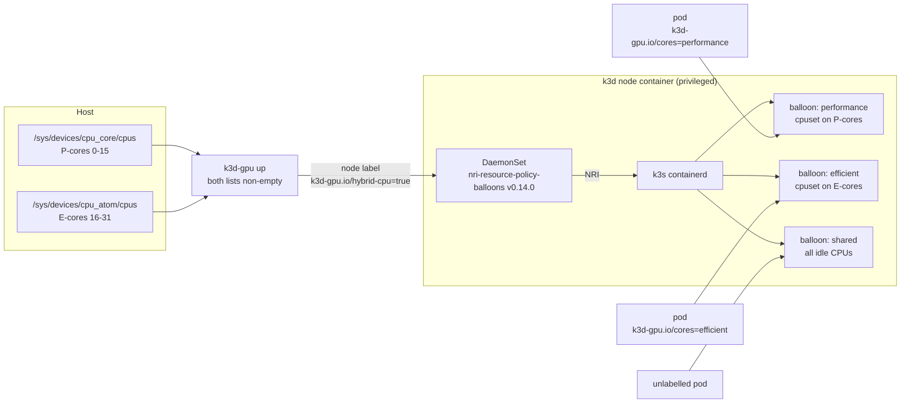

# k3d-gpu on Intel platforms

k3d-gpu turns one Linux machine into a single-node k3d cluster that schedules the
Intel accelerators it finds: Arc / Core Ultra / Xe GPUs, the Core Ultra NPU,
Gaudi 3, the Xeon DSA, IAA and QAT engines, AMX, and the P-cores and E-cores of
hybrid client CPUs. One command (`k3d-gpu up`) detects them from sysfs, starts
the matching Intel device plugins baked into the node image, and fails unless
each detected engine is advertised to the scheduler.

This page is for Intel's open-source, AI PC and partner engineering teams. It
says what is shipped, what has run on real hardware, and what has only run
against a simulated sysfs. Measured results are filled in from a ledger and are
never estimated. Every "no other" claim refers to the search log in
[provenance.md](https://github.com/88plug/k3d-gpu/blob/cbbc84e55d7f9a8270ccce9a7cec870304b76597/docs/provenance.md).

- [What it adds](#what-it-adds)
- [Local Kubernetes landscape](#local-kubernetes-landscape)
- [Capability matrix](#capability-matrix)
- [Run Intel Enterprise Agent Toolkit on one machine](#run-intel-enterprise-agent-toolkit-on-one-machine)
- [How hybrid P/E pinning works](#how-hybrid-pe-pinning-works)
- [Roadmap](#roadmap)

---

## What it adds

- **One node image, every Intel plugin.** The image bakes pinned upstream
  manifests into k3s's auto-deploy directory:
  [intel-device-plugins-for-kubernetes](https://github.com/intel/intel-device-plugins-for-kubernetes)
  `0.37.1` (GPU, NPU, DSA, IAA, QAT), `intel/gaudi-device-plugin:1.24.2-481` and
  [nri-plugins](https://github.com/containers/nri-plugins/releases/tag/v0.14.0)
  balloons `v0.14.0`. With the default image nothing is `kubectl apply`'d at
  run time. If a custom `K3D_GPU_IMAGE` lacks a baked DaemonSet, `up` applies
  the manifest from `K3D_GPU_SHARE`; for NVIDIA with no local manifest it falls
  back to the upstream `main` branch manifest from GitHub, which is unpinned.
- **Detection from sysfs.** The launcher reads PCI vendor/device IDs, the bound
  driver, DRM render nodes and `/dev/accel` nodes. That is how it tells an NPU
  (`8086` + `intel_vpu`) from a Gaudi (`1da3` + `habanalabs`) behind the same
  `/dev/accel/accel*` path.
- **Label gating.** The NPU, DSA, IAA, QAT, Gaudi and hybrid DaemonSets only
  schedule onto nodes carrying their label (the upstream NFD label where one
  exists, e.g. `intel.feature.node.kubernetes.io/npu=true`). The launcher sets
  the label only when the hardware and host setup are present. Two plugins are
  not gated by a positive label: the Intel GPU plugin runs on every amd64 node
  and idles, registering nothing, when there is no Intel GPU; the NVIDIA plugin
  runs unless the node carries `nvidia.com/gpu.present=false`, which `up` sets
  when NVIDIA is not active.
- **Platform-aware `doctor`.** Kernel and firmware checks per platform (Meteor,
  Arrow, Lunar, Panther and Wildcat Lake, Battlemage, Nova Lake), the
  `xe.force_probe=<id>` needed for parts newer than the kernel, and the missing
  host step for DSA/IAA work queues (`accel-config`) and QAT VFs
  (`sriov_numvfs`, `vfio-pci`). The launcher never changes host configuration
  itself.
- **A schedulability assertion.** `up` fails unless every detected engine has
  more than zero schedulable units. `test` runs one pod per engine: `nvidia-smi`
  for NVIDIA, a pod that requests the Intel resource and lists the device nodes
  it received, and for hybrid CPUs a check of the pod's `Cpus_allowed_list`
  against the host's P-core or E-core list.
- **P/E-core placement for pods.** One pod label,
  `k3d-gpu.io/cores: performance|efficient`, pins a pod to P-cores or E-cores.
  We found no other local Kubernetes that ships core-type-aware placement
  ([provenance.md, C2](https://github.com/88plug/k3d-gpu/blob/cbbc84e55d7f9a8270ccce9a7cec870304b76597/docs/provenance.md#3-c2-automatic-p-coree-core-pod-pinning-in-a-local-k8s)).

## Local Kubernetes landscape

Searched 2026-10-16 against each project's source at the commit linked. Where a
version is named, the link is that release tag's commit. Scope:
Kubernetes you run on one developer machine.

| Project | Accelerator support found | Intel GPU / NPU / Gaudi | Source |
|---------|---------------------------|-------------------------|--------|
| minikube v1.39.0 | `--gpus` accepts only `nvidia`, `nvidia.com`, `amd` or `all`, with the Docker driver and Docker runtime only. GPU addons are NVIDIA and AMD device plugins. | none | [`start.go#L1509`](https://github.com/kubernetes/minikube/blob/7a9f6a841470a207de8cf4bafcccee0969d8ba10/cmd/minikube/cmd/start.go#L1502-L1511), [`addons.go#L446-L476`](https://github.com/kubernetes/minikube/blob/7a9f6a841470a207de8cf4bafcccee0969d8ba10/pkg/minikube/assets/addons.go#L446-L476) |
| k3d v5.9.0 (upstream) | `--gpus` forwards Docker `DeviceRequests` (NVIDIA). The only accelerator doc is CUDA. No Intel mention in `docs/`, `cmd/` or `pkg/`. | none | [`docs/usage/advanced/`](https://github.com/k3d-io/k3d/tree/15dd1e2dbd62c53ed990fce9b7332335e8cb053c/docs/usage/advanced), [`translate.go#L107-L112`](https://github.com/k3d-io/k3d/blob/15dd1e2dbd62c53ed990fce9b7332335e8cb053c/pkg/runtimes/docker/translate.go#L107-L112) |
| MicroK8s | Core addons `nvidia` and `gpu` ("Alias to nvidia add-on"); community addon `amd`. Neither repo lists an Intel addon. | none | [core `addons.yaml#L72-L83`](https://github.com/canonical/microk8s-core-addons/blob/0f192230dc3df263eb95b6be4c3f00a6ea037879/addons.yaml#L72-L83), [community `addons.yaml#L237-L240`](https://github.com/canonical/microk8s-community-addons/blob/151b98e87dc7c29411cac7127170dc1c7605ec33/addons.yaml#L237-L240) |
| Rancher Desktop v1.24.0 | None. The Rancher Desktop 2 alpha announcement says "GPU support isn't built yet"; GPU requests are open issues ([#5561](https://github.com/rancher-sandbox/rancher-desktop/issues/5561), [#8487](https://github.com/rancher-sandbox/rancher-desktop/issues/8487), [#3968](https://github.com/rancher-sandbox/rancher-desktop/issues/3968)). | none | [blog post, L46-L48](https://github.com/rancher-sandbox/docs.rancherdesktop.io/blob/0a32ddb28ccba0ee344b587fb61a9b53e2281619/blog/2026-06-19-welcome-to-rancher-desktop-2.md?plain=1#L46-L48) |
| kind | None. "Device plugin, e.g. GPU" is listed under lowest-priority scope; [#3164](https://github.com/kubernetes-sigs/kind/issues/3164) "Support GPUs" is open. | none | [`project-scope.md#L104`](https://github.com/kubernetes-sigs/kind/blob/214d9fd1426470dcfa0d8aa1c5dda03bfea835cb/site/content/docs/contributing/project-scope.md?plain=1#L104) |
| Talos Linux | System extensions `i915`, `xe` and `intel-npu` ship kernel modules and firmware only; NVIDIA has a container-toolkit extension. No Intel device plugin is shipped. | kernel modules only | [`drm/`](https://github.com/siderolabs/extensions/tree/6e96d79367783e1c93f4aa5ed5bc7641a9a6604f/drm), [`nvidia-gpu/`](https://github.com/siderolabs/extensions/tree/6e96d79367783e1c93f4aa5ed5bc7641a9a6604f/nvidia-gpu) |

Any of these can run Intel's device plugins if you install and configure them
yourself. The difference is that k3d-gpu detects the hardware, gates and starts
the plugins, and asserts the result, with no manual step.

---

## Capability matrix

- **Detected**: `k3d-gpu detect` reports the engine from sysfs.
- **Scheduled**: `k3d-gpu up` starts its plugin (or sets its labels) and fails
  unless the cluster advertises more than zero units.
- **Verified on hardware**: `up` and `test` passed on a real host. The only host
  so far is an i9-13900T (P-cores 0-15, E-cores 16-31) with a UHD 770 iGPU
  (`8086:a780`, `i915`) and 2 NVIDIA GPUs, recorded in the
  [PR #9 test plan](https://github.com/88plug/k3d-gpu/pull/9): `up` reported
  `nvidia=2, intel=1, hybrid=1`. That run used commit `109154d`. The hybrid
  `test` there only checked that each pod printed its `Cpus_allowed_list`; the
  stricter check that the list sits inside the P-core or E-core list landed
  after it (`fb5c17d`) and has not yet run on hardware.
- **Verified by sim**: `tests/detect_test.sh` builds a fake sysfs/devfs tree,
  sets `K3D_GPU_SYSROOT`, and runs `detect`, `doctor` or `test` against it, with
  `docker`, `k3d` and `kubectl` stubbed. 64 cases pass. Sim covers detection,
  diagnostics and the `test` pass/fail logic. It does not prove a plugin
  advertises the device.

| Engine | Kubernetes resource / label | Detected | Scheduled | Verified on hardware | Verified by sim (cases in `tests/detect_test.sh`) |
|--------|-----------------------------|----------|-----------|----------------------|------------------------------------------------|
| NVIDIA GPU | `nvidia.com/gpu` | yes | yes | **yes**, 2 GPUs; `nvidia-smi` pod passed | loaded module; `/dev/nvidiactl`; runtime vs. CDI-only; `test` output and failure |
| Intel GPU, `i915` | `gpu.intel.com/i915` | yes | yes | **yes**, UHD 770; device-listing pod passed | Meteor Lake, Arrow Lake-S kernel check, mixed `i915` + `xe` |
| Intel GPU, `xe` (Battlemage, Lunar / Panther Lake, Crescent Island) | `gpu.intel.com/xe` | yes | yes | no | Lunar Lake, Battlemage dGPU, kernel/firmware checks, `xe.force_probe` hints, `vfio-pci` excluded |
| Intel NPU | `npu.intel.com/accel` | yes | yes | no | Lunar / Meteor Lake, NPU vs. Gaudi, unbound NPU, firmware checks, forced `npu` fails `doctor` |
| Gaudi 3 | `habana.ai/gaudi` | yes | yes (plain mode, no habana runtime) | no | `habanalabs` accel nodes, no-driver case, NPU + Gaudi on one host |
| DSA | `dsa.intel.com/wq-user-*` | yes | yes | no | user work queues, no-work-queue case, `accel-config` hint, forced `dsa` fails `doctor` |
| IAA | `iaa.intel.com/wq-user-*` | yes | yes | no | user work queues, no-work-queue case, `accel-config` hint |
| QAT (C62x, 4xxx, 420xx, 6xxx) | `qat.intel.com/*` | yes | yes | no | 4xxx and C62x PF with VFs, no VFs, unbound PF, `vfio-pci` check |
| AMX | `feature.node.kubernetes.io/cpu-cpuid.AMX*=true` (labels, no plugin) | yes | yes (labels) | no | AMX flags detected and reported; CPU without AMX |
| Hybrid P/E cores | `k3d-gpu.io/hybrid-cpu=true`; pod label `k3d-gpu.io/cores` | yes | yes | **yes** at `109154d`: performance pod on CPU 0, efficient pod on CPU 20. The strict placement check in `test` is sim-only so far. | detection, no online E-cores, non-hybrid, forced, `doctor` lists, `test` placement pass and both failure modes |

The `xe`, NPU, Gaudi and Xeon rows have not run on hardware. If you have one of
these platforms, `k3d-gpu doctor && k3d-gpu up && k3d-gpu test` is the probe that
moves a row to verified. Please send its output.

---

## Run Intel Enterprise Agent Toolkit on one machine

[Intel Enterprise Agent Toolkit](https://github.com/intel/enterprise-agent-toolkit)
(EAT) deploys an agent stack (LiteLLM, vLLM on CPU, Redis, pgvector and an NRI
balloons policy) onto Kubernetes. It targets Xeon servers. We read it at
[`0ecf67a`](https://github.com/intel/enterprise-agent-toolkit/tree/0ecf67a); a
k3d-gpu cluster is a candidate bring-your-own target for a single developer
machine.

Facts from that snapshot that shape a k3d run:

- vLLM uses `vllm/vllm-openai-cpu:v0.24.0` and requires the node label
  `ei-inference-eligible=true` (`core/helm-charts/vllm/values.yaml`). That label
  is only applied on the toolkit's Kubespray path.
- No code path requests `gpu.intel.com`, `habana.ai` or `/dev/dri`. The OVMS
  chart defaults to `targetDevice: CPU` (`core/helm-charts/ovms/values.yaml:77`).
- The toolkit installs its own `nri-resource-policy-balloons` release in
  `kube-system`. Only one NRI resource policy can own a node, so drop `hybrid`
  from `K3D_GPU_VENDORS` before installing it.

Measured on the i9-13900T host above. Values come from the run ledger; a
placeholder still present means the measurement has not landed.

| ID | Measurement | Result |
|----|-------------|--------|
| H1 | `k3d-gpu up` to all nodes Ready and engines schedulable | <<FROM-LEDGER:H1>> |
| H2 | EAT deploy on k3d: outcome and wall time | <<FROM-LEDGER:H2>> |
| H3 | Changes needed for EAT to complete (labels, ports, prechecks) | <<FROM-LEDGER:H3>> |
| H4 | First chat completion through the EAT endpoint | <<FROM-LEDGER:H4>> |
| H5 | CPU inference throughput and latency, unpinned | <<FROM-LEDGER:H5>> |
| H6 | Same, inference on P-cores, agent services on E-cores | <<FROM-LEDGER:H6>> |
| H7 | Same model on the iGPU (`gpu.intel.com/i915`) | <<FROM-LEDGER:H7>> |

Each ID's exact command is recorded with its ledger entry. Numbers on this page
are copied from the ledger and nowhere else.

---

## How hybrid P/E pinning works

Intel hybrid CPUs (Alder Lake and newer) expose two perf PMUs:
`/sys/devices/cpu_core/cpus` lists the P-cores and `/sys/devices/cpu_atom/cpus`
the E-cores. When both list online CPUs, the launcher labels the node
`k3d-gpu.io/hybrid-cpu=true`. That label lets the baked
`nri-resource-policy-balloons` DaemonSet schedule. k3s already enables NRI in
its containerd for a privileged node, and the node container sees the host's
PMUs, so neither the host nor containerd needs changes.

The `BalloonsPolicy` `default` in `kube-system` (`share/nri-balloons.yml`) has
three balloon types. The first match wins:

| Balloon | Matches | CPUs |
|---------|---------|------|
| `performance` | pod label `k3d-gpu.io/cores=performance` | P-cores (`preferCoreType: performance`) |
| `efficient` | pod label `k3d-gpu.io/cores=efficient` | E-cores (`preferCoreType: efficient`) |
| `shared` | everything else (`AlwaysTrue`, `maxBalloons: 1`) | every idle CPU (`shareIdleCPUsInSame: system`) |

A balloon is sized by its pods' CPU requests. `kube-system` runs on a 1-CPU
reserve (`reservedResources.cpu: 1000m`). The policy only sets cpusets inside
the node's cgroup; cpufreq, C-states and RDT are untouched.



Use it:

```yaml
apiVersion: v1
kind: Pod
metadata:
  name: inference
  labels:
    k3d-gpu.io/cores: performance
spec:
  containers:
  - name: app
    image: busybox:1.37
    command: ["grep", "Cpus_allowed_list", "/proc/self/status"]
    resources:
      requests: {cpu: "4"}
      limits: {cpu: "4"}
```

`k3d-gpu test` runs one such pod per core type. It fails unless the pod's
`Cpus_allowed_list` sits inside the host's P-core or E-core list. A plain grep
would also pass with NRI off. On the i9-13900T, under the earlier grep-only
`test` (`109154d`), the performance pod ran on CPU 0, the efficient pod on
CPU 20, and an unlabelled pod could use `0-15,17-31`, every CPU except the
reserve. Those placements satisfy the strict check, but the strict `test` itself
has not run on that host yet.

---

## Roadmap

Planned, not shipped. Each item lands with its own test and, where it touches
hardware, a recorded run.

- **Agent endpoint.** `k3d-gpu agent`: an OpenVINO Model Server OpenAI-compatible
  endpoint that picks iGPU, Arc, NPU or CPU from the resources the node
  advertises.
- **EAT profile.** An `up` profile that sets the `ei-*-eligible` labels, maps
  ports 80/443, and installs balloons as a Helm release EAT can adopt, so both
  can share a node.
- **Report and bench.** `k3d-gpu report` (what was detected, scheduled and
  tested) and a `bench/` harness that writes the ledger this page reads.
- **Hardware coverage.** Move the `xe`, NPU, Gaudi, DSA, IAA, QAT and AMX rows to
  verified on real Core Ultra, Arc, Gaudi 3 and Xeon hosts.
- **Telemetry.** Per-engine metrics from the Intel GPU and NPU exporters.
- **Upstream.** Small, separate fixes for running EAT and its successor
  installer on k3s: accept `+k3s` versions in platform detection, pass Istio's
  `global.platform`, pin the nri-plugins chart, and label nodes on
  bring-your-own clusters.
